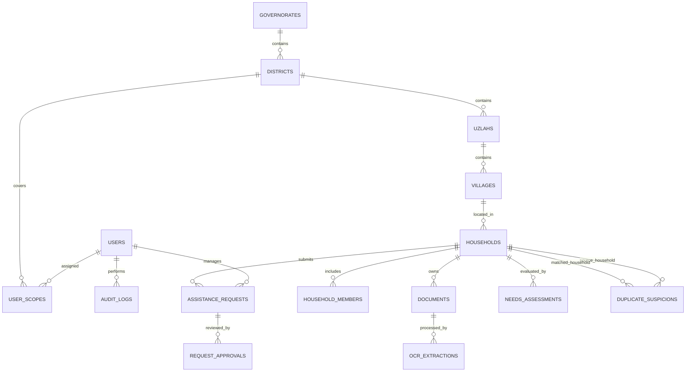

# Data Dictionary & Entity Relationship Diagram (ERD)
## قاموس البيانات ومخطط العلاقات الكينونية - رشاد AI

### الهيكل الكينوني

### الجداول الأساسية المعتمدة
1. `governorates`: المحافظات اليمنية.
2. `districts`: المديريات التابعة لكل محافظة.
3. `uzlahs`: العزل الإدارية.
4. `villages`: القرى والأحياء والحارات.
5. `users`: المستخدمين والموظفين والباحثين.
6. `user_scopes`: النطاق الجغرافي المصرح به لكل موظف.
7. `households`: الأسر والمستفيدين مع دعم المعرفات المؤقتة والمعرفات التحليلية المستعارة (Pseudo IDs).
8. `household_members`: أفراد الأسرة وصلة القرابة والحالة الصحية والتعليمية والعمل.
9. `documents`: وثائق الإثبات المرفوعة ومساراتها المحمية.
10. `ocr_extractions`: نتائج استخراج النصوص العربية ونسب الثقة وحالة التحقق البشري.
11. `needs_assessments`: مؤشرات الاحتياج المحسوبة والعوامل التفسيرية والشارة الاسترشادية.
12. `duplicate_suspicions`: حالات الاشتباه بالازدواجية والتكرار ونسب التشابه والاعتماد الثنائي للدمج.
13. `assistance_requests`: طلبات المساعدات ومصارف الزكاة المستهدفة وحالة الطلب.
14. `request_approvals`: سجل التوصيات والاعتمادات المتسلسلة أو اللجانية.
15. `audit_logs`: سجل التدقيق المحمي غير القابل للتعديل أو الحذف (Append-Only).
